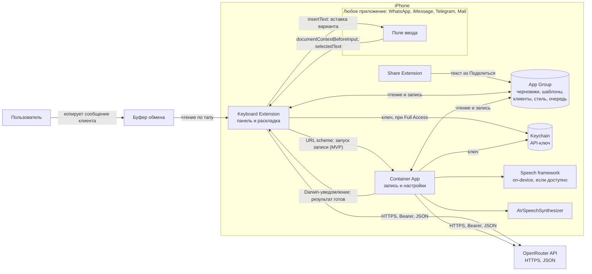

# ТЗ: YAY Keyboard AI (iOS)

| Поле | Значение |
|---|---|
| Версия | 0.10, черновик для согласования (поправки после проверки реализуемости) |
| Дата | 2026-11-04 |
| Язык документа | Русский (интерфейс приложения: иврит, русский, английский) |
| Платформа | iPhone, iOS 17+ |
| Объём работ | Только спецификация, без кода |

**Как читать.** Приоритеты: **MVP** (первый релиз), **v1** (после MVP), **v2** (идеи, не обязательства). Утверждения об iOS, которые не подтверждены официальной документацией или прототипом, помечены как «требует проверки» и собраны в разделе 13.

**Связанные документы.**
- [`IOS_FEASIBILITY.md`](IOS_FEASIBILITY.md): проверка реализуемости на iOS, риски App Review, чек-лист прототипов S-1…S-11, решение go/no-go.
- [`AI_PROMPTS.md`](AI_PROMPTS.md): рабочие промпты, JSON-схемы, запросы к OpenRouter, кэширование, набор оценки качества.

Если этот документ расходится с ними в технических деталях (промпты, параметры запроса, App Review), правильным считается специализированный документ.

### Поправки после проверки реализуемости (обязательны к учёту)

1. **Голос в MVP: как просил заказчик, и сразу с запасным путём.** В сборку входят оба пути, оба доводятся до релиза:
   - **Основной (запрос заказчика):** тап 🎤 на панели клавиатуры → открывается экран записи приложения → пользователь говорит → возврат в мессенджер → варианты ответа в панели. Это FR-02. Риск: Guideline 4.4.1 прямо запрещает клавиатуре открывать другие приложения, кроме «Настроек». Похожие клавиатуры в App Store так делают, но гарантии одобрения нет.
   - **План Б (готов в той же сборке):** системная диктовка в поле, затем кнопка «✨ Сделать ответ», которая превращает надиктованный текст в деловое сообщение по намерению (S-4). Ещё один путь: Action Button или ярлык с экраном записи (S-5).
   - **Если App Review отклонит переход**, основным становится план Б. Это решение принимается после ответа ревью, без переделки продукта.
   - **Запрещено:** скрывать переход от ревьюера (флаги, удалённое включение после одобрения). Это нарушение Guideline 2.3.1 и прямой путь к блокировке аккаунта разработчика. В заметках для ревью переход описывается честно (раздел 9.7).
   - **Фоновая аудио-сессия** (мгновенный старт записи без показа экрана) остаётся экспериментом. Её включают только после прототипа S-2. Подробно: `IOS_FEASIBILITY.md`, разделы 5 и 8.

2. **Без Full Access клавиатура обязана оставаться рабочей.** Раскладка, вставка и встроенные шаблоны, вшитые в само расширение, работают без него. Генерация, App Group, буфер обмена и пользовательские шаблоны требуют Full Access. Также учесть:
   - в защищённых полях и полях телефона iOS принудительно включает системную клавиатуру;
   - некоторые приложения запрещают сторонние клавиатуры.
3. **Системный промпт полностью статичный** и написан на английском. Тон, язык ответа и стиль передаются в пользовательском блоке, иначе любая смена настроек сбрасывает кэш. Дополнительно в промпт входят:
   - пол пользователя: в иврите глаголы первого лица различаются по роду;
   - защита от инструкций внутри текста клиента (prompt injection);
   - запрет на кириллические плейсхолдеры внутри текста на иврите.

   Канонические тексты промптов: `AI_PROMPTS.md`.
4. **Стриминг включён в MVP**, иначе цель «первый вариант не позже 3 с» недостижима. Параметры: `max_tokens` около 1200, отдельные таймауты на каждый этап (раздел 7.3). Цель «не больше 1 цента за ответ» реалистична только для быстрой категории моделей.
5. **Возврат в чат клиента** возможен по ссылке (`wa.me`, `tg://`, `sms:`), если в карточке клиента есть телефон. Это v1. Бюджет памяти клавиатуры: не больше 40 МБ. Правки текста пользователем (`editedText`) - самый сильный сигнал для обучения стилю.

### Вариант «личная сборка» (только для своего iPhone)

Если приложение ставится только на свой телефон (или телефоны команды) и не публикуется в App Store, App Review его не проверяет. Тогда ограничения из **правил App Store** не действуют. Технические ограничения **самой iOS** остаются.

| Ограничение | Личная сборка | Публикация в App Store |
|---|---|---|
| Переход из клавиатуры в приложение для записи (4.4.1) | ✅ Можно, это основной путь | ⚠️ Риск отказа |
| Фоновая аудио-сессия для мгновенной записи (2.5.4) | ✅ Можно (батарея - проверить, S-2) | ⚠️ Риск отказа |
| Клавиатура без Full Access обязана работать | Не обязательно | Обязательно |
| Микрофон внутри клавиатуры | ❌ iOS запрещает технически | ❌ |
| Кнопка над системной клавиатурой в чужих приложениях | ❌ iOS запрещает технически | ❌ |
| Чтение переписки WhatsApp/iMessage | ❌ iOS запрещает технически | ❌ |
| Нажать «Отправить» в мессенджере | ❌ iOS запрещает технически | ❌ |

Способы установки:

| Способ | Цена | Срок работы | Для кого |
|---|---|---|---|
| Xcode + бесплатный Apple ID | 0 | 7 дней, потом переустановка с Mac | Только свой телефон, проба |
| Xcode + Apple Developer Program | 99 $ в год | до 1 года | Свой телефон и до 100 устройств (Ad Hoc) |
| TestFlight, внутренние тестировщики | входит в 99 $ | 90 дней на сборку | До 100 человек из команды, без ревью |

**Сборка без Mac (только Windows и iPhone).** Собрать iOS-приложение можно только на macOS (Xcode), но Mac можно арендовать в облаке.

| Путь | Цена | Как работает | Минусы |
|---|---|---|---|
| **A. Codemagic + TestFlight** (рекомендуется) | 99 $/год Apple; Codemagic - бесплатный лимит минут macOS в месяц (проверить актуальный) | Код в GitHub → Codemagic собирает и подписывает → TestFlight → установка на iPhone из приложения TestFlight | Нужен платный аккаунт Apple |
| **B. GitHub Actions + Sideloadly** | 0 | Код в GitHub → сборка на облачном Mac GitHub Actions (неподписанный .ipa) → Sideloadly на Windows подписывает бесплатным Apple ID и ставит по кабелю | Переустановка каждые 7 дней; лимит бесплатных App ID; поддержка App Groups у бесплатного аккаунта - проверить (без неё клавиатура и приложение не обмениваются данными); отладка без Xcode сложная |
| **C. Аренда облачного Mac** (MacinCloud и аналоги) | почасовая оплата | Удалённый рабочий стол с Xcode из Windows | Платно; телефон подключается к чужому Mac только по сети/через TestFlight |

**Рекомендация:** начать с личной сборки (Developer Program, 99 $). Это снимает риск ревью для MVP. Публикация в App Store - позже, с планом Б (FR-02b).

### Соответствие запросу заказчика

Каждый пункт исходного запроса и как он закрыт. Колонка «Только на телефоне»: «да» значит, что работу пункта нельзя подтвердить в симуляторе или по документации, только на реальном iPhone (прототипы S-1…S-11 из `IOS_FEASIBILITY.md`).

| Запрос заказчика | Как выполнено | Статус | Только на телефоне |
|---|---|---|---|
| Кнопка ассистента над клавиатурой во всех приложениях | Панель ассистента сверху собственной клавиатуры. Над системной клавиатурой iOS кнопку разместить не даёт | ⚠️ Иначе, чем в запросе: нужно один раз переключиться на клавиатуру YAY | да (S-3, S-7, S-9) |
| Без переключения клавиатур | Компактная раскладка he/ru/en внутри YAY, поэтому возвращаться к системной клавиатуре почти не нужно | ⚠️ Частично | да (S-9) |
| Голос → намерение, не диктовка | Переход в приложение для записи (FR-02) и план Б (FR-02b). ИИ переписывает смысл в деловой текст | ✅ Риск ревью по 4.4.1 | да (S-1, S-4, S-10) |
| Видит сообщение клиента и 5–10 сообщений истории | Буфер обмена, выделенный текст, Share Extension. Читать чужую переписку iOS не даёт | ⚠️ Нужно одно действие пользователя: скопировать | да (S-8) |
| Тоны и стиль пользователя | Четыре тона, стиль-профиль, лайк/дизлайк, правки пользователя | ✅ | нет |
| OpenRouter, ключ пользователя, выбор модели, кэш промпта | `AIClient`, Keychain, список моделей, статичный префикс | ✅ | нет (проверить по документации OpenRouter) |
| Локальная речь (iOS Speech) + генерация в OpenRouter | `SFSpeechRecognizer`, на устройстве, где поддерживается | ✅ | да (S-10: иврит на устройстве) |
| 2 касания: кнопка → говорить → текст в поле | Тап 🎤 → речь → свайп «вставить». Плюс шаг возврата в мессенджер | ⚠️ 2 касания + возврат | да (S-1) |
| Вставить / Вставить + прочитать вслух / Вставить и отправить | Вставить ✅. Озвучка ✅ в приложении, из клавиатуры - после S-6. «Отправить» iOS не даёт: вставка + подсказка | ⚠️ Отправка вручную | да (S-6) |
| One-Tap Rewrite (4 режима) | Меню Rewrite в панели | ✅ | да (S-9: замена текста) |
| Шаблоны, настраиваемые голосом | Встроенные + свои, создание голосом | ✅ | нет |
| Память клиента | Карточки клиентов, извлечение из переписки с подтверждением | ✅ | нет |
| Вход he/ru → деловой иврит, автоопределение | Автоопределение языка, перевод варианта на русский | ✅ | да (S-10) |
| Режим тишины | Настройка «Тихий режим» | ✅ | нет |
| Ключ в Keychain, ничего без согласия | Keychain, нет своего сервера, экраны согласия | ✅ | да (S-3: доступ из клавиатуры) |
| Автосохранение черновиков | Черновики в App Group | ✅ | нет |
| Обучение стилю (лайк/дизлайк) | Few-shot из лайков, обновление профиля | ✅ | нет |
| Панель не закрывает клавиатуру, волна, 2–3 варианта, свайпы | Раздел 5 | ✅ | да (S-7: память) |
| Не делать полноценную клавиатуру | Минимальная клавиатура: без неё в чужие приложения не попасть | ⚠️ Минимум, без которого продукт невозможен | нет |

---

## 1. Резюме продукта

**Проблема.** Пользователь ведёт переписку с клиентами каждый день (iMessage, WhatsApp, Telegram, почта). Иврит пишет неуверенно, поэтому сейчас цикл выглядит так: скопировать сообщение клиента → открыть внешний AI-чат → вставить и описать задачу → скопировать ответ → вернуться в мессенджер → вставить. Цикл занимает около минуты и отвлекает от разговора.

**Решение.** Приложение YAY Keyboard AI даёт ассистента прямо в любом поле ввода:
- панель ассистента над системной клавиатурой (собственная клавиатура);
- голосовая команда, которая понимается как **намерение**, а не как диктовка: «скажи, что цена обсуждаема и предложи созвон во вторник»;
- ответ по контексту (последние 5–10 сообщений клиента), в выбранном тоне и на деловом иврите;
- варианты ответа с переводом на русский для проверки;
- вставка выбранного варианта свайпом.

**Целевой пользователь.** Риелтор, менеджер продаж или фрилансер в Израиле, который общается с клиентами на иврите, а думает или формулирует по-русски.

**Метрика успеха.**

| Метрика | Сейчас (оценка, измерить) | Цель MVP | Цель v1 |
|---|---|---|---|
| Время от «клиент написал» до «ответ вставлен в поле» (голос) | ~60 с | ≤ 8 с | ≤ 5 с |
| Время до вставки ответа (Rewrite выделенного текста) | ~30 с | ≤ 4 с | ≤ 3 с |
| Доля ответов, вставленных без ручной правки | не измеряется | ≥ 50 % | ≥ 65 % |
| Доля принятых вариантов (лайк или вставка) | не измеряется | ≥ 60 % | ≥ 70 % |

**Цели продукта**
- Сократить цикл ответа клиенту до 2 нажатий плюс голос.
- Сохранить деловой тон и язык иврит без ошибок в формулировках.
- Пользователь сам решает, что и когда уходит в сеть и когда отправлено сообщение.

**Вне scope (явно).**
- Полноценная замена системной клавиатуры для набора текста.
- Автоматическая отправка сообщений клиентам.
- Чтение переписки в мессенджерах напрямую (через API мессенджеров или экран).
- Собственный сервер для хранения переписки (MVP работает без backend).
- Android, iPad-оптимизация, Apple Watch.

---

## 2. Ограничения iOS и как мы их обходим

Таблица сопоставляет каждое требование исходного запроса с ограничением платформы и решением продукта.

| # | Требование | Почему нельзя напрямую | Решение в продукте | Статус |
|---|---|---|---|---|
| 1 | Кнопка ассистента над клавиатурой в любом приложении | Input Accessory View работает только внутри собственного приложения. Встроить код в системную клавиатуру нельзя | Собственная клавиатура (Custom Keyboard Extension) с панелью ассистента сверху | Реализуемо |
| 2 | Голосовой ввод | У расширения клавиатуры нет доступа к микрофону. Системная диктовка недоступна сторонним клавиатурам | MVP: тап 🎤 в клавиатуре → запись в основном приложении → возврат (по запросу заказчика, риск 4.4.1). В той же сборке план Б: системная диктовка, затем «✨ Сделать ответ», а также Action Button или ярлык | Реализуемо с ограничением (см. «Поправки» в начале) |
| 3 | Контекст: история переписки, 5–10 сообщений | Клавиатура видит только текст текущего поля (`documentContextBeforeInput`, `documentContextAfterInput`), не экран и не другие приложения | Контекст через буфер обмена (блок сообщений), выделенный текст, Share Extension (сценарий 4D). Пользователь копирует контекст сам | Реализуемо, нужен один шаг пользователя |
| 4 | «Вставить и отправить» | Нет доступа к кнопке «Отправить» чужого приложения. `insertText("\n")` срабатывает не во всех полях и не нажимает Send в мессенджерах | Вставка варианта и подсказка «Нажмите отправить». Отправку делает пользователь | **Не реализуемо, заменено** |
| 5 | Чтение вслух (Insert + read aloud) | Озвучка из основного приложения - через AVSpeechSynthesizer. Из расширения клавиатуры - требует проверки (аудио-сессия, ограничения расширения) | Озвучка в контейнере (MVP). Из клавиатуры - только если прототип подтвердит (O-05) | Частично |
| 6 | Режим тишины | Нет ограничений платформы | Настройка «Тихий режим»: без звуков, вибрации и озвучки, подтверждения только текстом | Реализуемо |
| 7 | Полная замена клавиатуры | Расширение без Full Access не имеет сети. Жёсткий лимит памяти расширения. App Review предъявляет требования к клавиатурам. Набор текста на расширении хуже системного | Минимальная клавиатура: панель 52 pt и компактная раскладка he/ru/en, которая открывается по кнопке глобуса. Полноценный набор остаётся за системной клавиатурой | Осознанное решение |
| 8 | Автоматическая отправка клиенту | Невозможна поверх чужих приложений. Требует прав, которых у сторонних приложений нет | Пользователь нажимает Send сам. Продукт этого не делает | Не делаем |
| 9 | Доступ к переписке для «умных» подсказок | Песочницы приложений. Нет API мессенджеров для iMessage/WhatsApp на стороне клиента | Пользователь копирует или выделяет текст, либо отправляет его через Share Extension | Не делаем напрямую |

**Почему минимальная клавиатура - единственный легальный способ.** Расширение клавиатуры (Custom Keyboard Extension) - единственный публичный API, который встраивается в поле ввода любого приложения. Share Extension и App Intents работают через системные листы и ярлыки, но не внутри поля ввода. Поэтому продукт получает клавиатуру, но сознательно минимальную: панель ассистента 52 pt сверху и компактную раскладку ниже, которую можно свернуть. Всё остальное делает системная клавиатура.

**Что это значит для пользователя.** Сценарий «голос → вставка» занимает два касания (тап на микрофон и свайп вставки), плюс речь и шаг возврата в MVP. Сценарий «Rewrite» - одно касание для открытия меню и одно для выбора стиля.

---

## 3. Архитектура системы

### 3.1 Компоненты

| Компонент | Назначение | Технология | Доступ к App Group / Keychain | Сеть |
|---|---|---|---|---|
| Container App (YAY) | Онбординг, запись голоса, распознавание, настройки, клиенты, шаблоны, стиль, озвучка | SwiftUI, iOS 17+ | чтение и запись / чтение и запись | да |
| Keyboard Extension | Панель ассистента, варианты, Rewrite, шаблоны, компактная раскладка he/ru/en | `UIInputViewController` | чтение и запись / чтение ключа (требует проверки без Full Access, O-06) | да, только при Full Access |
| Share Extension | Принимает текст из «Поделиться», формирует контекст клиента | `NSExtensionActivationRule` на текст | запись контекста / нет | да (генерация из листа) |
| App Intents | Ярлыки, запуск записи из Shortcuts, Action Button, Back Tap (v2) | AppIntents, `openAppWhenRun` | через App Group | нет |
| App Group `group.<bundle>` | Общие настройки, черновики, шаблоны, память клиентов, очередь голосовых задач | `UserDefaults(suiteName:)`, файлы в контейнере группы | - | - |
| Keychain (access group) | API-ключ OpenRouter | Keychain Services, `kSecAttrAccessibleAfterFirstUnlockThisDeviceOnly` | общая группа Keychain | - |
| Распознавание речи | Голос в текст, he-IL / ru-RU / en-US | `SFSpeechRecognizer`, on-device при поддержке локали | - | настраивается |
| Озвучка | Чтение вариантов вслух | `AVSpeechSynthesizer` | - | нет |
| OpenRouter | Генерация вариантов ответа | HTTPS, `Authorization: Bearer`, JSON | - | внешний сервис |

Собственного сервера в MVP нет. Все запросы идут напрямую из приложения и клавиатуры в OpenRouter.

### 3.2 Диаграмма потоков данных



### 3.3 Ключевые технические решения

1. **Один общий модуль `AIClient`** (локальный Swift-пакет) подключён к приложению, клавиатуре и Share Extension. Формирует промпты, вызывает OpenRouter, валидирует JSON.
2. **Сеть из клавиатуры только при Full Access.** Без Full Access генерация недоступна, клавиатура показывает баннер (состояние S8). Шаблоны и вставка работают.
3. **Тяжёлые операции - только в контейнере:** распознавание речи, работа с записью, озвучка, миграции базы. Клавиатура держит только панель, раскладку и результаты.
4. **Передача голоса (MVP, основной путь по запросу заказчика; план Б - см. «Поправки» п.1):** клавиатура запускает запись через URL scheme (`yayai://voice?task=<id>`). Контейнер пишет результат в App Group и шлёт Darwin-уведомление. Клавиатура подхватывает результат, когда она видима. Если клавиатура закрыта, результат ждёт в очереди.
5. **Лимит памяти расширения.** По сообщениям разработчиков, ориентир около 60–70 МБ. Точное значение Apple не публикует (O-09). Следствия: нет больших кэшей и изображений в клавиатуре; список клиентов ограничен (top-N по последней активности, остальные подгружаются по поиску); модель данных в клавиатуре читается лёгкими средствами; замер на старых устройствах обязателен до релиза.
6. **Один ключ, одно хранилище.** API-ключ - только в Keychain. Всё остальное - в App Group. Клавиатура не хранит данные вне App Group.

### 3.4 Основные потоки

- **Голос (MVP):** клавиатура → URL scheme → контейнер (запись, распознавание) → OpenRouter (из контейнера) → результат в App Group → Darwin-уведомление → клавиатура показывает варианты.
- **Голос (v1, фоновая сессия):** контейнер держит активную аудио-сессию в фоне → клавиатура сигналит через App Group и Darwin-уведомление → запись стартует без перехода → результаты в клавиатуре. Требует прототипа (O-02).
- **Rewrite / шаблоны / текст без голоса:** клавиатура → `AIClient` → OpenRouter → варианты в панели. Переходов в приложение нет.
- **Share Extension:** лист «Поделиться» → Share Extension → генерация → результат в буфер или черновик → пользователь вставляет в мессенджер.

---

## 4. Пользовательские сценарии

Во всех сценариях состояния панели соответствуют разделу 5.2.

### 4A. Голосовой ответ на входящее сообщение (основной сценарий)

**Предусловия:** клавиатура YAY включена, Full Access выдан, ключ OpenRouter сохранён, разрешены микрофон и распознавание речи.

| Шаг | Действие пользователя | Что происходит в системе | Состояние панели |
|---|---|---|---|
| 1 | В WhatsApp выделяет сообщение клиента (или блок из 5–10 сообщений) и нажимает «Копировать» | Текст попадает в буфер | - |
| 2 | Открывает поле ввода, переключается на YAY (кнопка глобуса) | Клавиатура при показе читает буфер (см. O-07 про баннер системы) и показывает чип «Клиент: 1 сообщение, 124 симв.» | S0 idle |
| 3 | Нажимает кнопку микрофона | MVP: открывается YAY через URL scheme, экран записи стартует сам. v1: если фоновая сессия активна, запись стартует сразу | S1 recording (в MVP - подсказка «Запись в YAY», таймер) |
| 4 | Говорит команду: «Скажи, что цена обсуждаемая, предложи созвон во вторник» | Запись, живая волна в экране YAY | S1 |
| 5 | Нажимает «Готово» или ждёт авто-стопа (пауза 1,5 с, настраивается) | Распознавание: on-device, если доступно, иначе по сети Apple (зависит от настроек). Текст команды виден для проверки | S2 transcribing |
| 6 | Возвращается в мессенджер. MVP: подсказка «Вернитесь в WhatsApp» (способ возврата зависит от версии iOS). v1: возврат не нужен, если работает фоновая сессия | Результат записан в App Group. Клавиатура получает Darwin-уведомление или читает результат при показе | S2 → S3 |
| 7 | Ждёт ответ (обычно до 3–5 с) | `AIClient` отправляет запрос в OpenRouter (из контейнера, если запись шла там) | S2 thinking |
| 8 | Видит 2–3 варианта, перевод на русский по тапу на «RU» | Один вариант виден целиком, точки-индикаторы показывают остальные | S3 results |
| 9 | Свайпом вправо вставляет текущий вариант | `insertText`. Подсказка «Вставлено. Проверьте и нажмите отправить». Вариант сохраняется как черновик | S4 inserted |
| 9a | Или свайпом влево запрашивает другой вариант | Новый запрос с флагом «другой вариант» (максимум 3 подряд, далее пауза 10 с) | S2 → S3 |
| 9b | Или долгим нажатием правит текст | Поле редактирования в панели, раскладка открывается | S3 edit |
| 10 | Нажимает 👍 или 👎 (чип, не обязательно) | Запись Feedback для стиля (FR-26) | S4 |

**Итого касаний:** два (микрофон и свайп вставки) плюс речь и, в MVP, возврат в мессенджер.

**Ветвления:**
- Нет интернета: S6. Команда и контекст сохраняются в очередь, генерация запускается по появлении сети (по запросу пользователя, не автоматически).
- Нет ключа: S7, CTA «Открыть YAY».
- Нет Full Access: S8, голос работает (через приложение), но генерация клавиатурой - нет. Баннер ведёт к инструкции.
- Команда пустая или не распознана: показывается транскрипт и «Повторить запись».
- Ответ не распарсился после ретрая: S5 с кнопкой «Повторить», черновик команды сохранён.

### 4B. One-Tap Rewrite

**Цель:** переписать уже набранный или выделенный текст в другом стиле без голоса.

| Шаг | Действие | Результат |
|---|---|---|
| 1 | Пользователь набрал текст или выделил фрагмент | Клавиатура читает `selectedText`, если выделения нет - весь текст поля через `documentContextBeforeInput` + `documentContextAfterInput` |
| 2 | Нажимает «Rewrite» в панели | Меню из четырёх пунктов: Профессиональнее / Короче / Вежливее / Убедительнее (S9) |
| 3 | Выбирает стиль | S2 thinking, запрос в режиме `rewrite` |
| 4 | Видит 1–2 варианта | S3 results |
| 5 | Свайпом вправо заменяет исходный текст | Если было выделение: `deleteBackward` (в большинстве полей удаляет выделение), затем `insertText`. Если выделения не было: удаляется текст поля до курсора и вставляется вариант. Поведение зависит от поля, проверяется на матрице приложений (раздел 11) |

**Ограничения:** текст длиннее 2000 симв. - предупреждение и предложение выделить фрагмент. Поле с текстом, который клавиатура не видит полностью, - режим «выделение обязательно».

### 4C. Быстрые шаблоны

| Шаг | Действие | Результат |
|---|---|---|
| 1 | Нажимает «Шаблоны» в панели | Сетка шаблонов (S10): встроенные «Спасибо за интерес», «Нужно уточнить», «Предложить созвон» + пользовательские |
| 2 | Тап по шаблону | Вставка текста без ИИ (мгновенно, работает без Full Access) |
| 3 | Долгое нажатие → «Персонализировать» (v1) | ИИ подставляет имя клиента, дату, объект из памяти клиента, пользователь подтверждает |
| 4 | Голосом: «Добавь шаблон: попросить паспорт и дату визита» (v1) | Распознаётся как интент `template_create`, шаблон предлагается к сохранению |

Шаблон - это текст с опциональными переменными `{имя}`, `{объект}`, `{дата}`. Переменные заменяются при вставке, если значения известны из памяти клиента.

### 4D. Ответ через Share Extension

**Зачем:** когда текст клиента пришёл длинным блоком или нужно выбрать клиента перед ответом.

| Шаг | Действие | Результат |
|---|---|---|
| 1 | В мессенджере выделяет сообщения, нажимает «Поделиться» | Система показывает лист |
| 2 | Выбирает YAY | Открывается лист Share Extension с текстом |
| 3 | Выбирает клиента из списка (или подтверждает автоподсказку по имени) и тон | Контекст клиента подтянут из памяти (если разрешено) |
| 4 | Нажимает «Ответить» или диктует команду (через контейнер) | Генерация, 2–3 варианта |
| 5 | Нажимает «Копировать» или «Сохранить черновик» | Текст в буфере или в черновиках |
| 6 | Возвращается в мессенджер и вставляет | Пользователь нажимает Send сам |

**Важно:** Share Extension не вставляет текст в поле мессенджера. Вставка возможна только через клавиатуру или буфер.

### 4E. Первый запуск и онбординг

| Экран | Текст и действие |
|---|---|
| E1. Приветствие | «YAY Keyboard AI - ответы клиентам голосом. Настройка займёт около 3 минут.» Кнопка «Начать» |
| E2. Включение клавиатуры | Пошаговая инструкция: Настройки → Основные → Клавиатура → Клавиатуры → Новые клавиатуры → YAY → включить «Полный доступ». Текст про Full Access: «Полный доступ нужен, чтобы клавиатура могла обращаться к ИИ и получать настройки из приложения. Мы не читаем вашу переписку и не отправляем её без вашего запроса». Кнопка «Открыть Настройки» (открывает приложение Настройки; прямой переход к экрану клавиатуры не гарантирован) |
| E3. Ключ OpenRouter | Поле ключа, кнопка «Вставить из буфера», проверка ключа пробным запросом. Ссылка «Как получить ключ» |
| E4. Доступы | Микрофон и распознавание речи, с объяснением, зачем нужны. Отказ - голос отключён, остальное работает |
| E5. Согласия | Переключатели (по умолчанию выключены): использовать память клиента; использовать примеры стиля; сохранять черновики 7 дней |
| E6. Выбор по умолчанию | Язык ответа (иврит по умолчанию), тон по умолчанию (деловой), модель (из списка) |
| E7. Готово | «Попробуйте: скопируйте сообщение клиента и нажмите микрофон в YAY». Кнопка «Открыть пример» (встроенный тестовый диалог без сети, если ключ не введён) |

---

## 5. UX-спецификация клавиатуры

### 5.1 Зоны и высоты (ориентиры, уточнить на устройствах)

| Зона | Высота | Содержимое |
|---|---|---|
| Панель ассистента | 52 pt | Кнопки: Микрофон, Rewrite, Шаблоны, Клиент. Справа - чип статуса (ключ, сеть, Full Access) |
| Область результатов | 150 pt, показывается в S2–S5 | Карточка варианта, точки-индикаторы, кнопка «RU», строка действий |
| Компактная раскладка | около 176 pt (4 ряда букв и нижний ряд) | Иврит, русский, английский. Переключение языка - кнопкой в нижнем ряду. Кнопка глобуса обязательна |
| Итого (idle) | около 230 pt | Ориентир, сопоставить с системной клавиатурой на iPhone SE и Pro Max |
| Итого (результаты) | около 200 pt | Раскладка букв скрыта, показана область результатов |

Раскладка букв закрыта в состояниях с результатом. Для набора текста пользователь возвращается к буквам жестом «ABC» / «אבג» или кнопкой в панели. Это сознательное упрощение: в одной высоте не помещаются и буквы, и карточки.

### 5.2 Состояния панели

| Код | Состояние | Что видно | Доступные действия | Переходы |
|---|---|---|---|---|
| S0 | idle | Панель, раскладка, чип «Клиент» (если буфер не пуст) | Все кнопки панели, набор текста | → S1, S9, S10, S11 |
| S1 | recording | Волна (MVP: только в экране YAY, в клавиатуре - таймер и «Запись в YAY»; v1: волна в клавиатуре), таймер, «Стоп», «Отмена» | Стоп, отмена (свайп вниз) | → S2, → S0 |
| S2 | transcribing / thinking | Скелетон карточки, «Думаю…», текст команды (после распознавания) | Отмена | → S3, S5, S6 |
| S3 | results | Карточка варианта, точки, «RU», «Правка» | Свайп вправо (вставка), влево (другой вариант), долгое нажатие (правка) | → S4, S2, S0 |
| S4 | inserted | Тост «Вставлено. Нажмите отправить» на 2 с, чип 👍 / 👎 | Оценка, озвучка (если разрешено) | → S0 |
| S5 | error | Текст ошибки человеческим языком, «Повторить» | Повторить, отменить | → S2, S0 |
| S6 | offline | «Нет сети. Команда сохранена.» | «Повторить когда будет сеть», «Отмена» | → S2, S0 |
| S7 | no key | «Добавьте ключ OpenRouter в YAY» | CTA «Открыть YAY» | → S0 |
| S8 | no Full Access | Баннер «Включите полный доступ для ИИ» | Инструкция, шаблоны работают | → S0 |
| S9 | rewrite menu | Четыре пункта: Профессиональнее / Короче / Вежливее / Убедительнее | Выбор пункта | → S2 |
| S10 | templates grid | Сетка шаблонов, «Добавить» (v1) | Тап - вставка, долгое нажатие - персонализация (v1) | → S0 |
| S11 | client chip | Список клиентов (top-10 по активности), поиск | Выбрать клиента, «Без клиента» | → S0 |
| S12 | silent indicator | Значок «тихий режим» в чипе статуса | Переключение в настройках | применимо ко всем |

### 5.3 Жесты

| Жест | Где | Действие |
|---|---|---|
| Свайп вправо | карточка варианта | Вставить вариант |
| Свайп влево | карточка варианта | Запросить другой вариант (максимум 3 подряд, потом пауза 10 с) |
| Долгое нажатие | карточка варианта | Открыть правку в панели |
| Тап по точке | индикатор | Переключить вариант |
| Свайп вниз | панель записи | Отмена записи |
| Тап по чипу «RU» | карточка | Показать перевод на русский (или английский) |

Жесты не конфликтуют: карточка одна, листания между вариантами - через точки, а не горизонтальный пейджинг.

### 5.4 Визуальные правила

- **RTL:** иврит выравнивается справа (`semanticContentAttribute` = `.forceRightToLeft` для иврита). Русский и английский - слева. Смешанный текст - по первому сильному символу.
- **Тема:** светлая и тёмная, системные цвета, токены цветов в дизайн-системе. Контраст не ниже WCAG AA.
- **Dynamic Type:** в клавиатуре - ограничение до категории «xxL»; карточки переносятся, а не обрезаются.
- **Касания:** минимальная цель 44×44 pt для кнопок панели. Клавиши раскладки - по стандарту системной клавиатуры.
- **Haptics:** лёгкий импульс при вставке и при начале записи. В тихом режиме выключены.
- **VoiceOver:** все кнопки панели и варианты имеют подписи, варианты читаются целиком.
- **Звуки:** системные звуки клавиш сохраняются по настройкам iOS.

### 5.5 Волна записи

- Волна - 40–60 столбцов, обновление до 20 кадров в секунду.
- MVP: волна рисуется в экране записи контейнера (там есть микрофон).
- v1 (фоновая сессия): уровень передаётся клавиатуре через App Group, обновление не чаще 10 Гц, только пока клавиатура видима. Это увеличивает нагрузку на память и батарею, поэтому v1 проверяется отдельно (R-03).

---

## 6. Функциональные требования

Приоритеты: **MVP** / **v1** / **v2**. Критерии приёмки (КП) формулируются так, чтобы их можно было проверить на устройстве.

### 6.1 Голос и намерение

| ID | Требование | Приоритет | Критерий приёмки |
|---|---|---|---|
| FR-01 | Запись голоса в контейнере с распознаванием he-IL / ru-RU / en-US. Язык - по выбору или автоопределению | MVP | Запись до 60 с. Транскрипт показан до отправки. При отказе микрофона - текстовый ввод |
| FR-02 | Переход из клавиатуры в контейнер для записи и возврат | MVP (запрос заказчика; риск 4.4.1, план Б - FR-02b) | Экран записи открыт не дольше 1,5 с после тапа (целевой показатель, устройство среднего класса). Подсказка возврата показана, если iOS не вернул пользователя сам |
| FR-02b | План Б голоса: системная диктовка в поле, затем «✨ Сделать ответ» (намерение → деловой текст). Плюс Action Button или ярлык с экраном записи | MVP | Работает без перехода из клавиатуры. Результат по качеству не хуже, чем у FR-02 на тех же фразах |
| FR-03 | Фоновая аудио-сессия для мгновенного старта записи из клавиатуры | v1 | Включается явно пользователем. Индикатор активной сессии в приложении. Старт записи без перехода подтверждён на прототипе (O-02) |
| FR-04 | Волна и таймер при записи | MVP (экран YAY), v1 (клавиатура) | Волна обновляется плавно, без рывков. Таймер точен до секунды |
| FR-05 | Интерпретация голоса как намерения, а не диктовки. Команда извлекается в поле `intent`, текст команды не вставляется дословно | MVP | Тест-набор из 30 команд: доля ответов, где дословно скопирована команда, не более 5 % |
| FR-06 | Авто-стоп записи по паузе (1,5 с, настраивается) | MVP | Срабатывает при тишине 1,5 с ±0,3 с. Выключается в настройках |
| FR-07 | Отмена записи свайпом вниз или кнопкой | MVP | Отмена не отправляет запрос, команда не сохраняется |

### 6.2 Контекст

| ID | Требование | Приоритет | Критерий приёмки |
|---|---|---|---|
| FR-08 | Контекст из буфера обмена: чтение по тапу, без автоматического чтения при открытии клавиатуры | MVP | Чтение буфера только по действию пользователя. Чип показывает число сообщений и длину |
| FR-09 | Контекст из выделенного текста (`selectedText`) и текста поля (`documentContextBeforeInput`) | MVP | Выделение имеет приоритет над буфером. Текст поля используется как дополнительный контекст |
| FR-10 | Разбор блока переписки на сообщения (от 1 до 10) | MVP | Блок из 10 сообщений разбирается на отдельные реплики по строкам и отметкам времени. При неоднозначности - просьба проверить |
| FR-11 | Ограничение контекста: до 10 последних сообщений и 4000 симв. суммарно | MVP | Лишнее обрезается с предупреждением. Отправляемый объём виден в UsageLog |
| FR-12 | Контекст из Share Extension (текст из листа «Поделиться») | v1 | Текст принимается из мессенджеров. Тест на iMessage, WhatsApp, Telegram, Mail |
| FR-13 | Контекст из снимка экрана (распознавание текста Vision) | v2 | Идея, не обязательство. Требует отдельного согласия и проверки качества иврита |

### 6.3 Генерация и тон

| ID | Требование | Приоритет | Критерий приёмки |
|---|---|---|---|
| FR-14 | Генерация 2–3 вариантов ответа одним запросом | MVP | Ответ содержит 2–3 варианта в JSON по схеме (раздел 7.8). Невалидный JSON - один ретрай, затем S5 |
| FR-15 | Тоны: дружелюбный, деловой, убедительный, сдержанный; режим «авто» | MVP | Выбранный тон виден в ответе. Тест на 10 контекстах: тон распознаётся оценщиком в 8 из 10 случаев |
| FR-16 | Экономичность ответа: ответ ведёт к следующему шагу (созвон, показ, уточнение, решение) и не содержит лишних обещаний | MVP | Каждый вариант содержит следующий шаг либо явный вопрос. Обещания цены и сроков только из памяти клиента или команды |
| FR-17 | Перевод каждого варианта на русский (или английский) для проверки | MVP | Перевод показан по тапу на «RU». Перевод не вставляется в поле |
| FR-18 | Многоязычность: вход he / ru / en, выход - иврит по умолчанию, или русский, или английский. Автоопределение языка входа | MVP | Русская команда даёт иврит. Тест 20 примеров на три языка |
| FR-19 | Одноразовый уточняющий вопрос, если данных недостаточно | MVP | Вопрос показан вместо вариантов, ответ пользователя добавляется к контексту |
| FR-20 | Регенерация свайпом влево; не более 3 подряд | MVP | Новый вариант отличается от предыдущего. После трёх запросов - пауза 10 с |
| FR-21 | Ручная правка варианта перед вставкой | MVP | Правка в панели. Вставляется отредактированный текст |

### 6.4 Rewrite и шаблоны

| ID | Требование | Приоритет | Критерий приёмки |
|---|---|---|---|
| FR-22 | One-Tap Rewrite: Профессиональнее / Короче / Вежливее / Убедительнее | MVP | Меню из четырёх пунктов. Результат за 4 с (цель). Исходный смысл сохраняется (оценка 9 из 10) |
| FR-23 | Замена выделения или текста поля вариантом | MVP | В матрице приложений (раздел 11) замена работает в WhatsApp, iMessage, Telegram, Mail, Notes |
| FR-24 | Встроенные шаблоны: «Спасибо за интерес», «Нужно уточнить», «Предложить созвон» | MVP | Вставка без сети. Тексты на иврите, русском и английском |
| FR-25 | Пользовательские шаблоны: создание, редактирование, порядок, удаление | MVP | Создание в приложении. Сохранение между запусками. Синхронизация с клавиатурой через App Group |
| FR-26 | Создание и изменение шаблона голосом | v1 | Команда «Добавь шаблон: …» → предложение текста → подтверждение |
| FR-27 | Переменные в шаблонах: `{имя}`, `{объект}`, `{дата}` | v1 | Переменные подставляются из памяти клиента. Неизвестные переменные остаются подсвеченными |

### 6.5 Память клиента

| ID | Требование | Приоритет | Критерий приёмки |
|---|---|---|---|
| FR-28 | Карточка клиента: имя, объект или услуга, бюджет или цена, этап сделки, заметки, история ключевых событий | v1 | Создание и редактирование в приложении. Хранение локально в App Group |
| FR-29 | Привязка переписки к клиенту: выбор вручную, подтверждение автоподсказки по имени | v1 | Автоподсказка показывается только как предложение. Без подтверждения клиент не выбирается |
| FR-30 | Обновление памяти по итогам ответа: модель предлагает изменения (`memory_updates`) | v1 | Изменения показаны пользователю, применяются только после подтверждения |
| FR-31 | Память клиента передаётся в запрос только для выбранного клиента и только при согласии | v1 | Без согласия поле `client_memory` пустое. Проверка по логу запроса |
| FR-32 | Список клиентов в клавиатуре: top-10 по активности, поиск | v1 | Список открывается за 300 мс при 500 клиентах в базе |

### 6.6 Черновики и история

| ID | Требование | Приоритет | Критерий приёмки |
|---|---|---|---|
| FR-33 | Автосохранение черновика: команда, контекст, выбранный и изменённый вариант | MVP | Сохранение через 2 с после изменения. Восстановление после закрытия клавиатуры |
| FR-34 | Срок хранения черновиков: 7 дней по умолчанию, настраивается, можно выключить | MVP | Очистка по сроку. Выключение сохраняет только текущий черновик в памяти |
| FR-35 | История черновиков с поиском по клиенту | v1 | Список за 30 дней, поиск по тексту и клиенту |

### 6.7 Обучение стилю

| ID | Требование | Приоритет | Критерий приёмки |
|---|---|---|---|
| FR-36 | Лайк и дизлайк вариантов, с необязательным комментарием | MVP | Оценка сохраняется локально с привязкой к варианту и тону |
| FR-37 | Стиль-профиль из примеров пользователя (вставленные тексты, лайкнутые ответы) | v1 | Профиль - короткое описание стиля (до 800 токенов) и 5–10 примеров. Редактируется вручную |
| FR-38 | Few-shot из лайкнутых ответов в запросе | v1 | До 5 примеров в запросе. Не более 1500 токенов. Включается в настройках |
| FR-39 | Сброс стиля одним действием | v1 | Очищает профиль и примеры. Подтверждение перед сбросом |

### 6.8 Озвучка, тишина, ошибки

| ID | Требование | Приоритет | Критерий приёмки |
|---|---|---|---|
| FR-40 | Чтение варианта вслух (AVSpeechSynthesizer), язык варианта | MVP (в приложении) | Озвучка в экране YAY. Из клавиатуры - только после подтверждения прототипом (O-05) |
| FR-41 | Тихий режим: без звуков, вибрации и озвучки, подтверждения текстом | MVP | Во всех состояниях нет звука и вибрации. Индикатор S12 |
| FR-42 | Обработка ошибок: сеть, ключ, лимит OpenRouter, таймаут, невалидный JSON | MVP | Каждая ошибка имеет текст на языке интерфейса и кнопку действия. Таймауты по этапам (раздел 7.3) |
| FR-43 | Очередь команд при отсутствии сети | MVP | Команда сохраняется. Повторный запуск - по действию пользователя |

### 6.9 Безопасность и приватность

| ID | Требование | Приоритет | Критерий приёмки |
|---|---|---|---|
| FR-44 | API-ключ хранится в Keychain, доступ по общей группе | MVP | Ключ не лежит в App Group, файлах и логах. Проверка аудитом |
| FR-45 | Первичное согласие и переключатели (раздел 9.3) | MVP | Без согласия данные клиента и стиля не уходят в сеть |
| FR-46 | Режим «не запоминать»: черновики и история не сохраняются | MVP | В режиме нет записей в App Group, кроме настроек |
| FR-47 | Удаление всех данных одним действием | MVP | Очищает App Group, черновики, клиентов, стиль, журнал. Ключ удаляется отдельно |
| FR-48 | Журнал использования: дата, модель, токены, стоимость, кэш-попадание, без текста | MVP | Текст переписки в журнале не хранится. Журнал очищается по кнопке |

### 6.10 Клавиатура и интеграции

| ID | Требование | Приоритет | Критерий приёмки |
|---|---|---|---|
| FR-49 | Панель ассистента 52 pt с кнопками Микрофон, Rewrite, Шаблоны, Клиент | MVP | Высота и расположение по разделу 5.1 |
| FR-50 | Компактная раскладка he / ru / en и кнопка глобуса | MVP | Кнопка глобуса работает во всех полях. Раскладка свернута в состоянии результатов |
| FR-51 | Вставка варианта свайпом вправо с подсказкой «Нажмите отправить» | MVP | Текст вставлен без лишних пробелов и переносов. Подсказка показана 2 с |
| FR-52 | «Вставить и отправить» | - | **Не реализуется** (раздел 2, строка 4). Заменено FR-51 |
| FR-53 | Запуск записи через кнопку Action (iPhone 15 Pro и новее), Back Tap, Shortcuts | v2 | Ярлык App Intents с `openAppWhenRun`. Проверка на устройствах с Action Button |
| FR-54 | Голосовая команда «Siri, ответь клиенту» | v2 | Через App Shortcuts. Требует проверки формулировок на иврите |
| FR-55 | Аналитика: время ответа, принятые варианты, доля правок | v2 | Только локально. Без передачи в аналитику третьих сторон |
| FR-56 | Live Activity на экране блокировки во время генерации | v2 | Идея. Требует проверки ограничений на фоновые обновления |

---

## 7. AI-слой

### 7.1 Пайплайн

1. **Сбор входа.** Транскрипт голоса или текст пользователя (режим Rewrite, шаблон), контекст (буфер, выделение, поле, Share Extension), выбранный клиент (если согласие), стиль (если согласие).
2. **Сборка запроса.** Стабильный префикс (системный промпт, стиль, память клиента), затем динамические данные (сообщения, команда). Порядок важен для кэширования (раздел 7.4).
3. **Запрос к OpenRouter.** Один вызов. Стриминг включён (первый вариант показывается по мере генерации). Таймауты по этапам (`AI_PROMPTS.md`, 9.3), один ретрай при 429, 5xx и сетевой ошибке с паузой 1 с.
4. **Разбор ответа.** Проверка JSON по схеме (раздел 7.8). Невалидный JSON - один повторный запрос с инструкцией «верни только JSON». Далее - ошибка S5.
5. **Показ.** Варианты в S3. Перевод и заметки подгружаются из того же ответа, без отдельного запроса.
6. **Постобработка.** Удаление пустых строк, проверка длины (в MVP не более 600 симв. на вариант), проверка языка варианта (должен совпадать с языком ответа).
7. **Журнал.** Токены, стоимость, cache-hit, модель, время. Текст не сохраняется (FR-48).

### 7.2 Модели и выбор

- В приложении две категории: **быстрая** (по умолчанию для Rewrite и коротких ответов) и **качественная** (по умолчанию для голосовых ответов с контекстом).
- Конкретные модели задаются в конфигурации приложения и выбираются пользователем в настройках из списка. Список поставляется с приложением; в v1 - загрузка списка через API OpenRouter.
- Список проверяется на три свойства: поддержка JSON-вывода, качество иврита (оценочный набор из 30 примеров), поддержка кэширования промпта у конкретного провайдера.
- Фолбэк: если выбранная модель недоступна (ошибка 4xx/5xx после ретрая), используется модель из той же категории из списка.
- Пользователь видит в настройках стоимость примерного ответа в его валюте (оценка по тарифу OpenRouter, обновляется вручную).

### 7.3 Параметры запроса

| Параметр | Значение (MVP) | Примечание |
|---|---|---|
| Температура | 0,5 для ответа, 0,3 для Rewrite | Меньше вариативности для деловых формулировок |
| `max_tokens` | около 1200 | 3 варианта на иврите с переводом занимают примерно 700–850 токенов |
| Таймаут | по этапам: до первого токена около 6 с, всего около 25 с | По FR-42, уточняется в `AI_PROMPTS.md`, 9.3 |
| Ретраи | 1 при 429, 5xx, сетевой ошибке | Пауза 1 с |
| Формат ответа | JSON по схеме, где поддерживается; иначе JSON-режим и проверка на клиенте | Проверяется на каждой модели из списка |
| Стриминг | включён в MVP | Без него цель «первый вариант не позже 3 с» недостижима |

### 7.4 Prompt caching

**Принцип:** всё стабильное идёт в начале запроса, всё меняющееся - в конце. Кэш работает по префиксу.

| Порядок | Блок | Меняется | Бюджет токенов (ориентир) |
|---|---|---|---|
| 1 | Системный промпт (раздел 7.5) | редко (при обновлении приложения) | около 1200 |
| 2 | Стиль-профиль и примеры | при изменении стиля | до 800 |
| 3 | Память выбранного клиента | при обновлении карточки | до 500 |
| 4 | Шаблон пользовательского промпта (раздел 7.6) с сообщениями | каждый запрос | 300–1500 |
| 5 | Команда пользователя (транскрипт) | каждый запрос | до 200 |

- Для моделей, где кэширование включается явно, блоки 1–3 помечаются cache-маркером, поддержанным OpenRouter для конкретного провайдера (детали - O-08).
- Для моделей с автоматическим кэшированием достаточно стабильного префикса.
- **Цели:** доля cache-hit на блоках 1–2 не ниже 80 % при серии из 5 запросов подряд к одному клиенту (проверка по полям `usage` ответа). Снижение стоимости фиксируется в журнале (FR-48).
- Память клиента в префиксе означает, что смена клиента сбрасывает кэш блока 3. Это ожидаемо.

### 7.5 Системный промпт (полный текст, MVP)

> **Заменён.** Каноническая версия - статичный английский промпт в `AI_PROMPTS.md`, раздел 2. Текст ниже оставлен как описание смысла правил.

Промпт на русском, так как пользователь и разработчики работают с ним на русском. Выход - иврит, если не задано иное.

```
Ты - ассистент для делового общения с клиентами. Пользователь - специалист по продажам или недвижимости. Он переписывается с клиентами в мессенджерах и почте.

Твоя задача: по намерению пользователя и контексту переписки подготовить ответ клиенту.

Правила:
1. Намерение, а не диктовка. Команда пользователя («скажи, что цена обсуждаемая, предложи созвон») - это указание, что написать. Не копируй команду дословно и не упоминай саму команду.
2. Язык ответа: {{output_language}}. По умолчанию - деловой иврит без сленга и без смешения языков. Если указан русский или английский - пиши на нём.
3. Ответ должен:
   а) учитывать последнее сообщение клиента и контекст переписки;
   б) быть коротким: обычно 1-4 предложения;
   в) продвигать сделку к следующему шагу: созвон, показ, уточнение бюджета или сроков, решение;
   г) не содержать обещаний цены, скидок, сроков и фактов, которых нет в контексте, памяти клиента или команде пользователя.
4. Тон: {{tone}}. Если тон «авто», подбери тон по контексту: клиент пишет коротко и по делу - сдержанный; клиент сомневается - убедительный; первый контакт - дружелюбный.
5. Стиль пользователя: {{style_summary}}. Примеры его текстов ниже, копируй манеру, но не формулировки.
6. Не выдумывай факты о клиенте. Если данных не хватает для ответа, верни needs_clarification = true и один короткий вопрос пользователю на его языке.
7. Верни от 1 до 3 вариантов. Варианты должны отличаться по формулировке и, при возможности, по следующему шагу.
8. Для каждого варианта дай перевод на {{review_language}} для проверки пользователем.
9. Отвечай только JSON по схеме, без текста вне JSON и без пояснений в markdown.
10. Персональные данные третьих лиц не добавляй, кроме переданных в контексте.
```

### 7.6 Шаблон пользовательского промпта (MVP)

```
Режим: {{mode}}                 // reply | rewrite | template
Канал: {{channel}}              // WhatsApp | iMessage | Telegram | Mail | other
Параметры: тон={{tone}}; вариантов={{n_variants}}; язык ответа={{output_language}}; перевод={{review_language}}
Текущее время: {{now}}; часовой пояс: {{tz}}

Команда пользователя (язык: {{input_language}}):
"""
{{transcript}}
"""

Последние сообщения переписки (от старых к новым, {{n_messages}} шт.):
{{#messages}}
- [{{role}}] {{text}}
{{/messages}}

Память о клиенте:
{{#client_memory}}{{client_memory}}{{/client_memory}}
{{^client_memory}}не передана{{/client_memory}}

Предыдущий вариант (только при регенерации): {{previous_variant_or_none}}
```

Для режима `rewrite`: поле `transcript` содержит исходный текст пользователя, поле `messages` пустое, а команда - выбранный стиль (например, «Убедительнее»).

Для режима `template`: вход - исходный текст шаблона и значения переменных, выход - один вариант с подставленными значениями.

### 7.7 Few-shot из лайкнутых ответов (v1)

- Берутся до 5 последних ответов с оценкой 👍 и тоном, совпадающим с текущим (или любым, если совпадений нет).
- Формат в промпте: пары «Контекст (1–2 строки) → Ответ (как вставлен)». Лимит 1500 токенов.
- Блок идёт в префиксе после стиль-профиля, чтобы кэшироваться.
- Ответы с 👎 не используются как образец, а попадают в список «избегать» (одно-два предложения в стиль-профиле).

### 7.8 JSON-схема ответа

```json
{
  "type": "object",
  "required": ["detected_input_language", "output_language", "variants", "needs_clarification"],
  "properties": {
    "detected_input_language": { "type": "string", "enum": ["he", "ru", "en", "unknown"] },
    "output_language": { "type": "string", "enum": ["he", "ru", "en"] },
    "intent": {
      "type": "object",
      "properties": {
        "kind": { "type": "string", "enum": ["reply", "decline", "ask_clarify", "propose_call", "propose_meeting", "send_info", "follow_up", "rewrite", "template"] },
        "summary_ru": { "type": "string", "maxLength": 200 }
      }
    },
    "variants": {
      "type": "array",
      "minItems": 1,
      "maxItems": 3,
      "items": {
        "type": "object",
        "required": ["id", "tone", "text", "translation_review"],
        "properties": {
          "id": { "type": "string", "pattern": "^v[1-3]$" },
          "tone": { "type": "string", "enum": ["friendly", "business", "persuasive", "restrained"] },
          "text": { "type": "string", "maxLength": 600 },
          "translation_review": { "type": "string", "maxLength": 600 },
          "next_step": { "type": "string", "enum": ["none", "call", "viewing", "clarify_budget", "clarify_timing", "decision", "other"] },
          "note_ru": { "type": "string", "maxLength": 160 }
        }
      }
    },
    "needs_clarification": { "type": "boolean" },
    "clarifying_question": { "type": ["string", "null"], "maxLength": 200 },
    "memory_updates": {
      "type": "array",
      "items": {
        "type": "object",
        "required": ["field", "value", "confidence"],
        "properties": {
          "field": { "type": "string", "enum": ["name", "object", "budget", "deal_stage", "note"] },
          "value": { "type": "string", "maxLength": 200 },
          "confidence": { "type": "number", "minimum": 0, "maximum": 1 }
        }
      }
    },
    "warnings": { "type": "array", "items": { "type": "string", "maxLength": 160 } }
  }
}
```

**Пример ответа (сокращённо):**

```json
{
  "detected_input_language": "ru",
  "output_language": "he",
  "intent": { "kind": "propose_call", "summary_ru": "Сказать, что цена обсуждаемая, предложить созвон во вторник" },
  "variants": [
    { "id": "v1", "tone": "friendly", "text": "...", "translation_review": "...", "next_step": "call", "note_ru": "Мягкий вариант" }
  ],
  "needs_clarification": false,
  "clarifying_question": null,
  "memory_updates": [],
  "warnings": []
}
```

Текст вариантов в примере не приведён намеренно: иврит в ТЗ не должен содержать непроверенных формулировок.

### 7.9 Валидация и ошибки

| Ситуация | Действие |
|---|---|
| Невалидный JSON | Один повторный запрос с добавлением «верни только JSON по схеме» |
| `variants` пуст | Ошибка S5 |
| Язык варианта не совпадает с `output_language` | Предупреждение в карточке, вариант помечен |
| `needs_clarification = true` | Показ вопроса (FR-19), варианты не показываются |
| Длина варианта больше 600 симв. | Обрезка до предложения, предупреждение |
| `memory_updates` с низкой уверенностью (< 0,7) | Не предлагаются к сохранению |

### 7.10 Оценка стоимости

- Стоимость одного ответа = (входные токены × цена входа) + (выходные токены × цена выхода). Кэшированные входные токены тарифицируются по своей цене (уточнить по тарифу выбранной модели, O-08).
- Ориентир на запрос: 1500–3000 входных токенов (из них 1200–2000 в кэшируемом префиксе), 300–600 выходных.
- Целевой показатель: средняя стоимость ответа не выше 1 цента при активном использовании 30 ответов в день (проверить после прототипа).
- Журнал (FR-48) показывает фактическую стоимость по каждому запросу.

---

## 8. Модель данных

### 8.1 Сущности

| Сущность | Поля (основные) | Где хранится | Примечание |
|---|---|---|---|
| Settings | `outputLanguage` (he / ru / en), `inputLanguages`, `defaultTone`, `model_fast`, `model_quality`, `silentMode`, `autoStopMs`, `ttsEnabled`, `consent_clipboard`, `consent_memory`, `consent_style`, `draftRetentionDays`, `neverRemember`, `fullAccessSeen` | App Group (UserDefaults) | Без секретов |
| ApiKeyRef | `provider = openrouter`, `keychainAccessGroup`, `lastValidatedAt` | Keychain (ключ) + App Group (метаданные без ключа) | Сам ключ - только в Keychain |
| StyleProfile | `id`, `summary` (до 800 токенов), `updatedAt`, `source` (manual / learned) | App Group (файл или SQLite) | Один профиль на пользователя |
| StyleExample | `id`, `text`, `kind` (sample / liked / disliked), `tone`, `createdAt` | App Group | Лимит 200 записей, старые вытесняются |
| Template | `id`, `title`, `body`, `variables[]`, `order`, `isBuiltIn`, `language` | App Group | Встроенные не удаляются |
| Client | `id`, `displayName`, `aliases[]`, `object`, `budget`, `dealStage`, `notes`, `lastActivityAt`, `channel` | App Group (SQLite) | Управляется пользователем |
| ClientEvent | `id`, `clientId`, `kind` (message / deal_change / note), `text`, `createdAt`, `source` (user / model_confirmed) | App Group | История для карточки |
| Conversation | `id`, `clientId?`, `channel`, `messages[]` (до 10), `capturedAt`, `source` (clipboard / selection / share / field) | App Group, ротация | Не сохраняется в режиме «не запоминать» |
| Draft | `id`, `commandTranscript`, `conversationId?`, `variants[]`, `selectedVariantId`, `editedText`, `status` (open / inserted / discarded), `updatedAt`, `expiresAt` | App Group | Срок - FR-34 |
| Feedback | `id`, `draftId`, `variantId`, `value` (like / dislike), `tone`, `comment?`, `createdAt` | App Group | Используется в v1 для стиля |
| VoiceTask | `id`, `status` (queued / recording / transcribing / done / failed), `transcript?`, `language`, `createdAt` | App Group | Очередь между клавиатурой и контейнером |
| UsageLog | `id`, `at`, `model`, `mode`, `inputTokens`, `outputTokens`, `cachedTokens`, `costEstimate`, `latencyMs`, `status` | App Group | Без текста переписки |

### 8.2 Правила

- **Синхронизация клавиатуры и приложения:** через App Group. Клавиатура читает при каждом показе и подписывается на Darwin-уведомления (`yay.draft.updated`, `yay.voice.done`). Конфликты записи - по времени последнего изменения, последний побеждает.
- **Миграции:** схема версионируется (`schemaVersion`). Миграции выполняет только контейнер. Клавиатура при несовместимой версии показывает «Откройте YAY для обновления».
- **Клиент (определение):** ручной выбор из списка (основной путь). Автоподсказка по имени из текста, если имя совпадает с алиасом. Подсказка не применяется без подтверждения (FR-29).
- **Время жизни:** черновики - 7 дней по умолчанию. Журнал - 30 дней. Очередь голоса - 24 часа. Контекст (Conversation) - до окончания черновика.
- **Лимиты:** клиентов в базе до 2000; шаблонов до 100; примеров стиля до 200.
- **Шифрование:** файлы App Group с защитой `completeUntilFirstUserAuthentication` (уточнить для фоновых задач, O-10).
- **Резервное копирование:** App Group не экспортируется в облако по умолчанию. Экспорт вручную в файл (v1), без ключа API.

### 8.3 Что клавиатура читает при открытии

Настройки (лёгкие), последние 20 черновиков (лёгкие поля), шаблоны, top-10 клиентов, статус ключа и Full Access. Полные списки клиентов и стиль в клавиатуру не загружаются (R-02).

---

## 9. Безопасность и приватность

### 9.1 Где что хранится

| Данные | Место | Защита |
|---|---|---|
| API-ключ OpenRouter | Keychain, общая группа | `AfterFirstUnlockThisDeviceOnly`, не в бэкапе |
| Настройки, шаблоны, клиенты, черновики, стиль | App Group | Защита файлов системой, без облака |
| Аудио записи | не сохраняется после распознавания (временный файл удаляется) | Временная директория, удаление сразу после транскрипции |
| Транскрипт команды | Draft / VoiceTask, срок по FR-34 | App Group |
| Журнал использования | UsageLog, без текста | App Group, очистка по кнопке |

### 9.2 Что уходит в OpenRouter

| Данные | Отправляется | По умолчанию | Согласие |
|---|---|---|---|
| Транскрипт команды пользователя | да, при каждом запросе | да | Неотключаемо: без него запрос невозможен |
| Текст сообщений клиента (контекст) | да, при каждом запросе | да | Пользователь сам копирует или выделяет текст |
| Память выбранного клиента | только если выбран клиент | нет | `consent_memory` |
| Стиль-профиль и примеры | да, если включено | нет | `consent_style` |
| Ключ API | только в заголовке запроса к OpenRouter | - | - |
| Имя устройства, идентификаторы, геолокация | нет | нет | - |
| Аудио | нет (распознавание на устройстве или у Apple, см. ниже) | - | - |

**Распознавание речи:** при on-device распознавании аудио не покидает устройство. Если локаль не поддерживает on-device или пользователь выключил настройку, распознавание идёт через серверы Apple. Эта возможность отображается в настройках и в тексте согласия (O-04).

### 9.3 Согласие и экраны

- Экран E5: три переключателя, все выключены по умолчанию (память клиента, стиль, черновики дольше текущей сессии).
- Перед первым запросом - краткое напоминание: «Текст, который вы вставили или продиктовали, отправляется в OpenRouter для создания ответа».
- В настройках - раздел «Приватность» с полным списком отправляемых данных (таблица 9.2) и ссылками на политику.
- Изменение согласия применяется к следующему запросу, без перезапуска.

### 9.4 Режим «не запоминать»

- Ничего не пишется в Draft, Conversation, Feedback и историю.
- Ответ показывается и вставляется, после закрытия клавиатуры остаётся только в памяти процесса.
- Журнал использования продолжает считать токены, но без текста (FR-48).

### 9.5 Удаление данных

- «Удалить все данные» очищает App Group, журнал, черновики, клиентов, стиль, шаблоны (кроме встроенных), настройки.
- Ключ API удаляется отдельной кнопкой.
- Удаление приложения удаляет App Group и Keychain-записи своей группы (уточнить поведение Keychain при переустановке, O-06).

### 9.6 Метки App Store (Privacy Nutrition Label) - черновик

| Категория | Черновая позиция | Статус |
|---|---|---|
| Пользовательский контент (сообщения, аудио) | Собирается, связан с пользователем: нет, если данные не передаются разработчику; передача OpenRouter - требует оценки | Требует юридической оценки (O-11) |
| Идентификаторы | не собираются | - |
| Данные об использовании | не собираются разработчиком (журнал локальный) | Подтвердить |
| Диагностика | не собирается, если не подключена аналитика (в MVP не подключена) | - |

Позиция по меткам зависит от того, считается ли OpenRouter обработчиком данных от имени разработчика. Решение - до подачи (O-11).

### 9.7 Заметки для проверки App Review

- **Полный доступ (Full Access):** обоснование для ревью: клавиатура обращается к сети для генерации ответов по команде пользователя и читает настройки из App Group. Без Full Access продукт отключает генерацию и показывает понятный баннер. Текст обоснования должен совпадать с онбордингом (E2) и описанием в App Store.
- **Клавиатура:** кнопка глобуса обязательна и работает. Клавиатура не записывает нажатия клавиш. Нажатия не отправляются в сеть.
- **Ключ API:** пользователь приносит свой ключ. Для проверки Apple нужен тестовый ключ с ограниченным лимитом, который передаётся через поле Review Notes в App Store Connect (риск R-09).
- **Запись голоса:** описание назначения микрофона в системном диалоге и в онбординге.
- **Правила:** проверить актуальную редакцию Review Guidelines перед отправкой (разделы о клавиатурах, о сборе данных и о доступе). Номера пунктов в этом документе не фиксированы.
- **Отзывы и рейтинг:** не просить оценку до первой успешной вставки.

---

## 10. Экраны основного приложения

| Экран | Содержимое | Поведение и поля |
|---|---|---|
| Главная | Статус (ключ, Full Access, микрофон), быстрые действия «Голос», «Копировать и ответить», последние 5 черновиков, счётчик ответов за неделю | Тап по черновику открывает его в редакторе. Статус с кнопкой исправления |
| Голос | Экран записи: волна, таймер, «Стоп», «Отмена», текст команды после распознавания, выбор клиента и тона, кнопка «Ответить» | Авто-стоп по настройке. Озвучка вариантов. Очередь команд из клавиатуры |
| Клиенты (v1) | Список с поиском, карточка: имя, алиасы, объект, бюджет, этап, заметки, события | Добавить вручную или из черновика (с подтверждением). Удалить клиента с его данными |
| Шаблоны | Список, порядок, редактор с переменными, предпросмотр, «Вставлять по умолчанию» | Встроенные можно скрыть, но не удалить |
| Стиль (v1) | Описание стиля (текст), примеры, лайкнутые и отклонённые ответы | Редактирование, сброс (FR-39) |
| Настройки | Ключ OpenRouter, модели по категориям, язык ответа, язык ввода, тон по умолчанию, голос (авто-стоп, озвучка), тихий режим, приватность, черновики, журнал, «Удалить данные» | Каждый раздел описан в 9.3 и 9.5 |
| Черновики | Список за срок хранения, поиск (v1), восстановление, удаление | Очистка по сроку |
| Журнал | Ответы, токены, стоимость, кэш-попадание, задержка | Без текста переписки |
| Онбординг | Экраны E1–E7 | Можно повторить из настроек |

**Вкладки:** Главная, Голос, Клиенты (v1), Шаблоны, Настройки. Стиль и Журнал - внутри Настроек и Главной.

---

## 11. Нефункциональные требования

| Категория | Требование | Как проверяем |
|---|---|---|
| Латентность, Rewrite | Первый вариант ≤ 4 с от нажатия пункта меню (p50), ≤ 7 с (p95) | Замер на устройстве, сеть Wi-Fi и LTE |
| Латентность, голос | От конца речи до первого варианта ≤ 3 с (p50) сверх времени распознавания; целевой общий путь ≤ 8 с (p50) | Замер 30 команд |
| Запуск клавиатуры | Показ панели ≤ 300 мс после открытия поля | Профилирование |
| Память расширения | Пик ≤ 60 МБ при обычной работе, нет роста при 50 запросах подряд | Инструменты разработчика, устройства старых моделей (поддерживаемые iOS 17) |
| Офлайн | Шаблоны, Rewrite-очередь, черновики работают без сети. Генерация - нет | Тест в авиарежиме |
| Надёжность | Ошибка сети не теряет команду; краш клавиатуры не теряет черновик | Тест сценариев сбоя |
| Совместимость | iOS 17 и новее. iPhone с поддержкой iOS 17 | Матрица устройств (раздел 12) |
| Языки | Интерфейс: иврит, русский, английский. RTL корректен во всех экранах | Проверка скриншотов |
| Доступность | VoiceOver, Dynamic Type до xxL в приложении, контраст WCAG AA | Аудит |
| Совместимость полей | Работа в WhatsApp, iMessage, Telegram, Mail, Notes, Safari | Матрица приложений, 5 полей на каждое приложение |
| Стоимость | ≤ 1 цента в среднем на ответ при 30 ответах в день (проверить) | Журнал |
| Локализация чисел и дат | Даты и время по часовому поясу пользователя | Тест |
| Конфиденциальность | Нет аналитики в MVP. Нет сторонних SDK, кроме Apple-фреймворков | Аудит зависимостей |

---

## 12. Роадмап

### MVP (4–6 недель)

- Клавиатура: панель 52 pt, компактная раскладка he/ru/en, кнопка глобуса, вставка свайпом (FR-49–FR-51).
- Голос: переход из клавиатуры в приложение для записи (FR-02) и план Б - диктовка + «✨ Сделать ответ», Action Button (FR-02b); распознавание, интерпретация намерения (FR-01–FR-07).
- Контекст: буфер (по тапу), выделение, текст поля, блок до 10 сообщений (FR-08–FR-11).
- Генерация: 2–3 варианта, четыре тона, перевод на русский, регенерация, правка, язык автоопределение (FR-14–FR-21).
- One-Tap Rewrite и встроенные шаблоны (FR-22–FR-24).
- OpenRouter с ключом в Keychain, выбор моделей, таймауты, ошибки, очередь, журнал (FR-42, FR-43, FR-44, FR-48).
- Черновики, тихий режим, озвучка в приложении, онбординг, согласия, удаление данных (FR-33, FR-34, FR-40, FR-41, FR-45–FR-47).
- Прототипы-проверки до старта разработки: O-02 (фоновая сессия), O-03 (Hebrew on-device), O-07 (чтение буфера), O-09 (память).

### v1 (после MVP, 4–6 недель)

- Память клиента: карточка, привязка, подтверждение обновлений, передача по согласию (FR-28–FR-32).
- Обучение стилю: лайки, профиль, few-shot, сброс (FR-36–FR-39).
- Share Extension (FR-12), история черновиков (FR-35).
- Фоновая аудио-сессия и мгновенный старт записи, волна в клавиатуре (FR-03, FR-04).
- Шаблоны голосом и переменные (FR-26, FR-27).
- Стриминг первого варианта (R-06).

### v2 (идеи, без обязательств)

- Action Button, Back Tap, Shortcuts (FR-53).
- Siri-команды (FR-54).
- Аналитика времени ответа и принятых вариантов (FR-55).
- Снимок экрана с распознаванием текста (FR-13), Live Activity (FR-56).
- Экспорт и импорт данных, синхронизация между устройствами (через iCloud, решение отдельно).

---

## 13. Риски и открытые вопросы

### 13.1 Риски

| ID | Риск | Влияние | Вероятность | Меры |
|---|---|---|---|---|
| R-01 | Ревью App Store отклонит клавиатуру из-за Full Access или открытия приложения из клавиатуры | Высокое | Высокая (4.4.1 запрещает клавиатуре открывать другие приложения) | План Б голоса готов в той же сборке (FR-02b), честное описание перехода в заметках для ревью, понятное обоснование, онбординг без давления, тестовый ключ для ревью, запасной сценарий без перехода (шаблоны и вставка) |
| R-02 | Память расширения превышает лимит на старых устройствах | Высокое | Средняя | Минимум данных в клавиатуре, замер, лимит списков, тяжёлые задачи в контейнере |
| R-03 | Фоновая аудио-сессия не даёт мгновенного старта записи или быстро расходует батарею | Высокое для v1 | Средняя | Прототип до старта v1; MVP работает без неё |
| R-04 | Возврат в мессенджер после записи не работает так, как ожидается | Среднее | Высокая | Явная подсказка в MVP, ожидаемость в тексте онбординга, отсутствие обещания автоматического возврата |
| R-05 | Качество иврита у моделей недостаточно для делового тона | Высокое | Средняя | Оценочный набор 30+ примеров, выбор модели пользователем, перевод для проверки, предупреждение о проверке |
| R-06 | Задержка выше целевой | Среднее | Средняя | Кэш промпта, короткий вывод, категории моделей, стриминг в v1 |
| R-07 | Стоимость на активного пользователя выше ожидаемой | Среднее | Средняя | Журнал, лимиты контекста, категории моделей, ориентир 1 цент на ответ |
| R-08 | Замена выделения работает не во всех полях | Среднее | Высокая | Матрица приложений, понятная подсказка при сбое вставки |
| R-09 | Тестовый ключ для ревью исчерпан или заблокирован | Среднее | Низкая | Лимит и мониторинг ключа, резервный ключ |
| R-10 | Изменения в правилах Apple или поведении OpenRouter | Среднее | Средняя | Проверка перед релизом, конфигурация моделей без пересборки (v1) |
| R-11 | Пользователь ожидает «вставить и отправить» и разочаруется | Среднее | Высокая | Честный онбординг, описание в ASO, подсказка «нажмите отправить» |
| R-12 | Юридические требования к обработке персональных данных клиентов пользователя (третьи лица) | Высокое | Средняя | Согласия, режим «не запоминать», удаление, предупреждение в онбординге, юридическая консультация до релиза |

### 13.2 Открытые вопросы (не подтверждено, требует проверки)

Утверждения ниже не считаются фактами, пока не проверены документацией Apple или прототипом.

| ID | Вопрос | Как проверить | Блокирует |
|---|---|---|---|
| O-01 | Можно ли из расширения клавиатуры открыть основное приложение, и как. Применяется неофициальный обход через responder chain или `extensionContext`. Публичного гарантированного способа не подтверждено | Прототип на iOS 17 и 18; поиск ответа в документации Apple; проверка ревью | 4A, FR-02 |
| O-02 | Можно ли стартовать запись из фонового состояния по Darwin-уведомлению при активной аудио-сессии контейнера, и сколько она живёт | Прототип с фоновым аудио-режимом, замер батареи и времени жизни | FR-03 (v1) |
| O-03 | Поддерживает ли `SFSpeechRecognizer` on-device распознавание иврита (he-IL) на всех целевых устройствах | `supportsOnDeviceRecognition` для локали, тест на 30 фразах | FR-01, 9.2 |
| O-04 | Какие данные отправляются Apple при серверном распознавании и как это описать в тексте согласия | Документация Apple на момент релиза | 9.2, 9.6 |
| O-05 | Можно ли озвучивать варианты из клавиатуры (аудио-сессия расширения) и насколько естественно звучит he-IL голос `AVSpeechSynthesizer` | Прототип; оценка слушателями | FR-40 |
| O-06 | Доступ к Keychain из клавиатуры без Full Access; поведение общей группы при переустановке | Прототип на устройствах с Full Access и без | 3.1, FR-44 |
| O-07 | Как системный баннер «Вставлено из ...» (iOS 16+) проявляется при чтении буфера клавиатурой по тапу, и показывается ли он при Full Access | Прототип, фиксация текста баннера | 4A шаг 2, FR-08 |
| O-08 | Поддержка явного cache-маркера в OpenRouter для выбранных моделей и фактическая экономия кэша | Тест на тарифе, сравнение `usage` | 7.4, 7.10 |
| O-09 | Точный лимит памяти расширения клавиатуры на поддерживаемых устройствах (ориентир 60–70 МБ, Apple не публикует точное значение) | Замер Instruments на устройствах | 3.3, R-02 |
| O-10 | Защита файлов App Group и доступность фоновых задач до первой разблокировки | Документация Apple, тест после перезагрузки | 8.2 |
| O-11 | Считается ли OpenRouter обработчиком данных от имени разработчика для меток App Store и для согласий | Юридическая оценка, условия OpenRouter | 9.6 |
| O-12 | Какие iPhone поддерживают Action Button и Back Tap в рамках iOS 17+ | Таблица совместимости Apple на момент релиза | FR-53 |
| O-13 | Качество делового иврита в выбранных моделях (оценка и стабильность) | Оценочный набор, слепая оценка | R-05, FR-15 |
| O-14 | Точная позиция клавиатуры по высоте на разных устройствах и совместимость с системной клавиатурой при смене языка | Замер на устройствах | 5.1 |
| O-15 | Стоимость и лимиты OpenRouter для пользователей (ограничения на кредиты, rate limits) | Тарифы и документация OpenRouter | 7.2, R-07 |

---

## 14. Маркетинг и ASO

### 14.1 Позиционирование

- **Для кого:** специалисты по продажам и недвижимости в Израиле и русскоязычные предприниматели, которые ведут переписку на иврите.
- **Обещание:** «Ответ клиенту голосом за секунды - на деловом иврите».
- **Честная формулировка:** «Вставляет ответ, вы сами нажимаете отправить». Это должно быть видно в ASO и на скриншотах (R-11).

### 14.2 Название и подзаголовок (лимит 30 символов каждое)

| Локаль | Название | Подзаголовок (варианты) |
|---|---|---|
| he | YAY Keyboard AI | מקלדת AI לתשובות ללקוחות |
| ru | YAY Keyboard AI | AI клавиатура: ответы клиентам |
| en | YAY Keyboard AI | AI keyboard for client replies |

### 14.3 Ключевые слова (поле ключевых слов, до 100 символов, через запятую)

| Локаль | Ключевые слова |
|---|---|
| he | מקלדת AI, עוזר כתיבה, תשובה ללקוח, כתיבה עסקית, מקלדת עברית, ניסוח הודעות, מענה ללקוחות |
| ru | AI клавиатура, ответ клиенту, клавиатура иврит, деловая переписка, переписать текст, шаблоны ответов, голос |
| en | AI keyboard, reply assistant, Hebrew keyboard, client replies, rewrite text, business messages, voice reply |

Каждую строку проверить на длину и на смысл. Ключевые слова не повторяют название и подзаголовок.

### 14.4 Скриншоты-сценарии (порядок)

1. Копирую сообщение клиента → 🎤 → «Скажи, что цена обсуждаемая, предложи созвон» (текст на иврите и русском).
2. Три варианта ответа с переводом на русский и свайп вставки.
3. Rewrite: выделенный текст → «Убедительнее» → результат.
4. Шаблоны: «Спасибо за интерес», «Нужно уточнить», «Предложить созвон».
5. Приватность: ключ в Keychain, согласия, «Удалить данные».

Скриншоты не должны показывать чужие переписки или реальные имена клиентов.

### 14.5 Идея лендинга

- Один экран: заголовок «Ответьте клиенту за секунды - голосом, на деловом иврите», демо-видео 20 секунд, блок «Что продукт не делает» (не отправляет сам, не читает переписку).
- Три блока: «Скажите, что хотите», «Выберите вариант», «Вставьте и отправьте сами».
- Языки: иврит, русский, английский с переключателем.

---

## 15. Приложение: глоссарий

| Термин | Простыми словами |
|---|---|
| Keyboard Extension (расширение клавиатуры) | Отдельная часть приложения, которая появляется как клавиатура во всех полях ввода |
| Full Access (полный доступ) | Настройка клавиатуры: разрешает сеть и обмен данными с приложением. Без неё клавиатура работает ограниченно |
| App Group | Общая папка и общие настройки для приложения, клавиатуры и Share Extension |
| Keychain | Защищённое хранилище системы для секретов, например ключа API |
| Share Extension | Пункт в листе «Поделиться», через который текст уходит в приложение |
| App Intents | Механизм для ярлыков, Siri и кнопки Action |
| Darwin-уведомление | Системный сигнал между процессами, быстрый способ сказать «результат готов» |
| SFSpeechRecognizer | Системный распознаватель речи Apple. Может работать на устройстве |
| AVSpeechSynthesizer | Системный синтезатор речи (озвучка текста) |
| documentContextBeforeInput | Текст в поле ввода до курсора, который клавиатура может прочитать |
| OpenRouter | Сервис, через который приложение обращается к моделям ИИ по одному ключу |
| Prompt caching (кэширование промпта) | Повторно используемое начало запроса, которое дешевле обрабатывать. Работает по префиксу |
| Few-shot | Примеры «вход → выход» в запросе, чтобы модель повторила стиль |
| Intent (намерение) | Что пользователь хочет получить, например «предложить созвон», а не дословный текст |
| RTL (right-to-left) | Письмо справа налево, как в иврите |
| Rewrite | Переписывание уже набранного текста в другом стиле |
| Тихий режим | Работа без звуков, вибрации и озвучки |
| ТЗ | Техническое задание: что сделать и как проверить, без кода |
